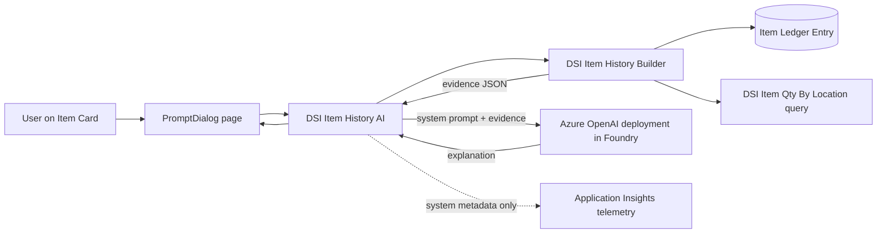

# BC Item History Copilot

[](https://github.com/andrecavalcanti/bc-item-history-copilot/actions/workflows/CICD.yaml)

A Copilot capability for **Microsoft Dynamics 365 Business Central** that explains an item's inventory history in plain language and flags anything unusual, such as drop-shipment entries that don't net to zero.

It is built with the Business Central **Copilot toolkit** (System.AI module) and calls a model deployed in your own **Microsoft Foundry / Azure OpenAI** resource.

<!-- Add a screenshot: save it as docs/images/explain-dialog.png and remove this comment -->
<!--  -->

---

## What it does

On the **Item Card**, the user chooses **Explain inventory history**, optionally asks a question, and chooses **Generate**. Copilot returns a short summary of recent movements, then any flags, for example:

> Drop-ship entries at location EAST total 4 instead of 0. Check the linked sales and purchase orders for a quantity received but not shipped.

The user can keep or discard the answer. Copilot never posts, changes or deletes data.

## Design principle: AL calculates, the model explains

LLMs are good at turning evidence into a readable explanation and unreliable at arithmetic. So the work is split deliberately:

| Responsibility | Done by | Why |
|---|---|---|
| Reading ledger entries | AL (partial records, read-only query) | Fast, permission-checked, deterministic |
| Totals per item, location and drop-ship flag | AL (`CalcSums`, query with `Method = Sum`) | Numbers must be exact |
| Deciding whether older entries were left out | AL | Avoids the model guessing about missing data |
| Explaining the history and suggesting checks | Model | What LLMs do well |
| Changing data | Nobody | The feature is read-only by design |

The deterministic part is covered by automated tests; the model's part is covered by an evaluation set (see below).

## Architecture



1. `DSI Item History Builder` collects the most recent entries (newest first, configurable limit) and pre-calculated totals into a JSON document.
2. `DSI Item History AI` sends a system prompt with strict rules plus the evidence wrapped in `<data>` tags to the model through the `Azure OpenAI` codeunit.
3. The answer is shown in a `PromptDialog` page. Telemetry logs success and duration only, never item numbers, prompts or answers.

## Repository structure

```
dsi-item-history-copilot/        Main app
  src/Copilot/                   Capability registration, AI codeunit, PromptDialog
  src/ItemHistory/               Evidence builder, query, Item Card extension
  src/Setup/                     Setup table and page (API key in IsolatedStorage)
  src/Permissions/               Permission set
dsi-item-history-copilot-test/   Test app (AL Test Tool)
.AL-Go/ .github/                 AL-Go for GitHub build, test and release pipelines
```

## Setup

**Requirements:** Business Central 27 or later (online, or a container for development), and an Azure subscription.

1. In **Microsoft Foundry**, create a project and deploy a chat model. Note the endpoint (`https://<resource>.openai.azure.com/`), deployment name and API key.
2. Install the app from the [latest release](https://github.com/andrecavalcanti/bc-item-history-copilot/releases/latest), or publish it from VS Code.
3. In Business Central, open **Copilot & agent capabilities** and make sure **Explain item inventory history** is active.
4. Open **DSI Copilot Setup**, enter the endpoint, deployment name and API key, and choose **Test Connection**.
5. Assign the **DSI Item Hist Copilt** permission set to users.

The capability is registered as **Preview** with billing type **Custom Billed**, because it uses your own Azure OpenAI resource.

## Tests

The test app runs on every push through AL-Go for GitHub. It tests the evidence builder only, so the tests are fast, free and repeatable, with no calls to Azure OpenAI.

| Test | Checks |
|---|---|
| `NoEntriesReturnsZeroTotals` | An item without entries returns zero totals |
| `NormalEntriesOnlyHaveZeroDropShipTotal` | Normal movements are totalled; drop-ship total stays 0 |
| `BalancedDropShipmentNetsToZero` | A standard drop shipment nets to zero |
| `UnbalancedDropShipmentIsReportedPerLocation` | An imbalance is reported at the right location |
| `EntryLimitMarksOlderEntriesOmitted` | Only the limit is sent; totals still cover all entries |
| `EntryCountEqualToLimitIsNotFlaggedAsOmitted` | Exactly the limit is not flagged as incomplete |
| `MostRecentEntryComesFirst` | The limit keeps the newest history |
| `ZeroLimitFallsBackToDefault` | A missing limit falls back to 50 |
| `PostedItemJournalIsIncludedInTotals` | Real posting is picked up correctly |

Writing these tests found a bug: an item with exactly the entry limit was reported as having older entries left out. It is fixed in the builder and covered by `EntryCountEqualToLimitIsNotFlaggedAsOmitted`.

## Evaluation

Model output is not deterministic, so it is checked against a fixed set of items with known histories, rerun after every prompt or model change. All data is synthetic (CRONUS demo company).

<!-- Fill in after each eval run -->

| # | Scenario | Expected answer | Correct? | Notes |
|---|---|---|---|---|
| 1 | Normal stock item | Summary, no flags | | |
| 2 | Balanced drop shipment | No drop-ship flag | | |
| 3 | Unbalanced drop shipment | Flags the location with the imbalance | | |
| 4 | More entries than the limit | Mentions older entries are not included | | |
| 5 | Item without entries | Says there is no history | | |
| 6 | User question about a specific location | Answers from that location's totals only | | |

**Model:** _deployment and version_ · **Last run:** _date_ · **Score:** _x / 6_

## Responsible AI and security

- **Read-only:** the model can only explain. The prompt forbids suggesting posting, deleting or modifying entries, and the code has no write path.
- **Human in the loop:** the user reviews every answer and chooses to keep or discard it.
- **Admin control:** the capability can be switched off on the Copilot & agent capabilities page.
- **Prompt injection:** evidence is passed inside `<data>` tags with an instruction to treat it as data. This reduces risk but is not a guarantee, which is why the feature has no write access.
- **Secrets:** the API key is stored in IsolatedStorage, never in tables or source code.
- **Data minimization:** only the fields needed for the explanation are sent, up to a configurable number of entries.
- **Telemetry:** system metadata only (success, duration).

## Roadmap

- [ ] HttpClient-mocked tests for error handling in the AI codeunit
- [ ] Structured JSON output with a confidence level
- [ ] Automated eval script that scores answers against the expected results
- [ ] Foundry agent that investigates imbalances through the Business Central MCP server, with human approval before any fix

## Tech stack

AL · Business Central Copilot toolkit (System.AI) · Microsoft Foundry / Azure OpenAI · AL Test Tool · AL-Go for GitHub · Application Insights
