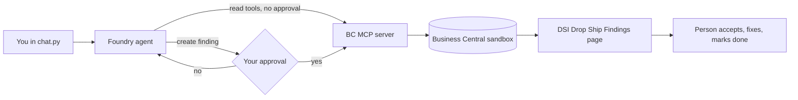

# Drop-Ship Investigator agent

A **Microsoft Foundry** agent that investigates drop-shipment imbalances in **Business Central online**
through the **Business Central MCP server**, and proposes a root cause and fix that a person must approve.



## Safety design

Four layers limit what the agent can do. If one fails, the next still holds:

| Layer | What it limits |
|---|---|
| BC MCP configuration | Only 5 API objects are exposed. Only the findings page allows create; nothing allows modify or delete. |
| BC API objects | The data pages are read-only. The findings page is read and create only. A new finding is always forced to status **New**. |
| Foundry approval policy | Only the 5 known read tools run without approval. Any other tool call, including tools with unexpected names, stops for your approval. |
| BC permissions | The agent acts as the signed-in user, with that user's permissions, and the audit trail shows who did what. |

The agent never posts, changes or deletes ledger entries or documents. A person reviews findings on the
**DSI Drop Ship Findings** page (Accept, Reject, Mark as Done) and carries out the fix.

## BC objects used by the agent

| Object | Purpose | MCP tool name |
|---|---|---|
| Query 50101 DSI Drop Ship Imbalance API | Item/location combinations that don't net to zero | `List_DropShipImbalances_QRY50101` |
| Page 50104 DSI Drop Ship Entries API | Drop-ship item ledger entries with order links | `List_DropShipEntries_PAG50104` |
| Page 50105 DSI Drop Ship Sales Lines API | Open drop-ship sales lines and linked purchase lines | `List_DropShipSalesLines_PAG50105` |
| Page 50106 DSI Drop Ship Purch Lines API | Open drop-ship purchase lines and linked sales lines | `List_DropShipPurchaseLines_PAG50106` |
| Page 50107 DSI Drop Ship Finding API | Existing findings, and creating new ones | `List_DropShipFindings_PAG50107`, `Create_DropShipFinding_PAG50107` |
| Page 50108 DSI Drop Ship Findings | Human review | (not exposed) |

All API objects use publisher `andreCavalcanti`, group `itemHistory`, version `v1.0`.

---

## Setup

You need: a Business Central online sandbox where you are admin, your Foundry project, Python 3.10+
and the Azure CLI.

### 1. Publish the app to your BC online sandbox

The BC MCP server works only with Business Central online, not with containers.

Add a SaaS configuration to `dsi-item-history-copilot/.vscode/launch.json`:

```json
{
  "name": "BC online sandbox",
  "type": "al",
  "request": "launch",
  "environmentType": "Sandbox",
  "environmentName": "Sandbox",
  "tenant": "<your BC tenant ID or domain>",
  "startupObjectId": 50108,
  "startupObjectType": "Page",
  "schemaUpdateMode": "ForceSync"
}
```

Select it in **Run and Debug**, run **AL: Download symbols**, then press **F5**.
Assign the **DSI Item Hist Copilt** permission set to your user.

### 2. Create some test data

You need at least one drop-ship imbalance. Recreate your **Test B** scenario in the sandbox, or any
scenario where drop-ship receipts and shipments for an item and location don't match. Check it on the
**Item Ledger Entries** page filtered on **Drop Shipment = Yes**.

### 3. Create the MCP configuration in Business Central

You need the **MCP - Admin** permission set.

1. Search for **Model Context Protocol (MCP) Server Configurations** and choose **New**.
2. **Name:** `DropShipInvestigator`. **Description:** Drop-ship investigator agent.
3. Leave **Active** off while you configure. Turn **Unblock Edit Tools** on (needed for creating findings).
4. Under **Server Features**, activate **API Tools**. Leave **Dynamic Tool Mode** off.
5. Under **Available APIs**, add these five objects with **API Version** `v1.0`:

   | Object Type | Object ID | Allow Read | Allow Create | Allow Modify | Allow Delete | Allow Actions |
   |---|---|---|---|---|---|---|
   | Query | 50101 | ✔ | | | | |
   | Page | 50104 | ✔ | | | | |
   | Page | 50105 | ✔ | | | | |
   | Page | 50106 | ✔ | | | | |
   | Page | 50107 | ✔ | ✔ | | | |

6. Choose **Validate** and fix any warnings, then turn **Active** on.
7. Choose **Advanced → Connection String** and note the **TenantId**, **EnvironmentName** and **Company**.

### 4. Register an Entra app for Foundry

Register it in the same Entra tenant as your Business Central trial.

1. **Microsoft Entra admin center → App registrations → New registration.**
   Name: `Foundry - BC Drop-Ship Investigator`. Supported account types: **Accounts in any organizational directory (multitenant)**. Register.
2. Copy the **Application (client) ID** and **Directory (tenant) ID**.
3. **Certificates & secrets → New client secret.** Copy the secret value now; it's shown only once.
4. **API permissions → Add a permission → Dynamics 365 Business Central → Delegated permissions →
   Financials.ReadWrite.All.** Then **Grant admin consent**.
5. Leave the redirect URI for now. Foundry gives it to you in the next step.

### 5. Create the OAuth connection in Foundry

1. In the Foundry portal, open your project, go to **Build → Tools → Connect a tool → Custom → MCP**.
2. **Name:** `bc-mcp`. **Endpoint:** `https://mcp.businesscentral.dynamics.com`
3. **Authentication:** **OAuth Identity Passthrough**, with:

   | Field | Value |
   |---|---|
   | Client ID | from step 4 |
   | Client secret | from step 4 |
   | Auth URL | `https://login.microsoftonline.com/<BC tenant ID>/oauth2/v2.0/authorize` |
   | Token URL | `https://login.microsoftonline.com/<BC tenant ID>/oauth2/v2.0/token` |
   | Refresh URL | same as Token URL |
   | Scopes | `https://api.businesscentral.dynamics.com/Financials.ReadWrite.All offline_access` |

4. Save, copy the **redirect URL** Foundry shows, and add it in the Entra app under
   **Authentication → Add a platform → Web → Redirect URIs**.

### 6. Install and configure the agent

```powershell
cd agent
python -m venv .venv
.venv\Scripts\activate
pip install -r requirements.txt
az login
copy .env.example .env
```

Fill in `.env`: the project endpoint (Foundry home page), your model deployment name, `bc-mcp`, and the
BC values from step 3. `.env` is in `.gitignore`, so it is never committed.

### 7. Create the agent and start investigating

```powershell
python create_agent.py
python chat.py
```

The first question opens a Business Central sign-in link (OAuth consent). Sign in with your BC user,
close the window, and press Enter. Then try:

- *Are there any drop-ship imbalances?*
- *Investigate the largest one.*
- *Record that as a finding.* → you see the exact tool call and must type `yes`.

Then open **DSI Drop Ship Findings** in Business Central to review the finding.
Every approval decision is logged in `agent/approvals.log`.

---

## Points still to confirm on the first run

These come from gaps in current documentation. Each has a planned fallback.

| # | What could happen | What to do |
|---|---|---|
| 1 | Foundry blocks the token: *"Cannot pass Microsoft token to untrusted MCP endpoint"* | The Foundry-hosted route won't work yet with BC's token audience. Fall back to running the agent loop locally with your own sign-in. |
| 2 | Consent or `tools/list` fails with a 401 or audience error | The scope in step 5 is wrong for the MCP server. Try `https://api.businesscentral.dynamics.com/.default offline_access`. |
| 3 | The agent can't find the tools, or asks approval for reads | The tool names differ from the expected pattern. The approval list in `create_agent.py` fails safe (it asks instead of acting); update `READ_ONLY_TOOLS` with the real names. |
| 4 | BC says the company or environment is missing | Foundry didn't send the headers alongside OAuth. Make `DropShipInvestigator` the **default** configuration in BC and check the values in `.env`. |

## Files

| File | Purpose |
|---|---|
| `instructions.md` | The agent's system prompt: background, tools, investigation method, rules |
| `create_agent.py` | Creates the agent in Foundry with the BC MCP tool and approval policy |
| `chat.py` | Console chat: handles sign-in consent, approval prompts and the audit log |
| `.env.example` | Settings template |
